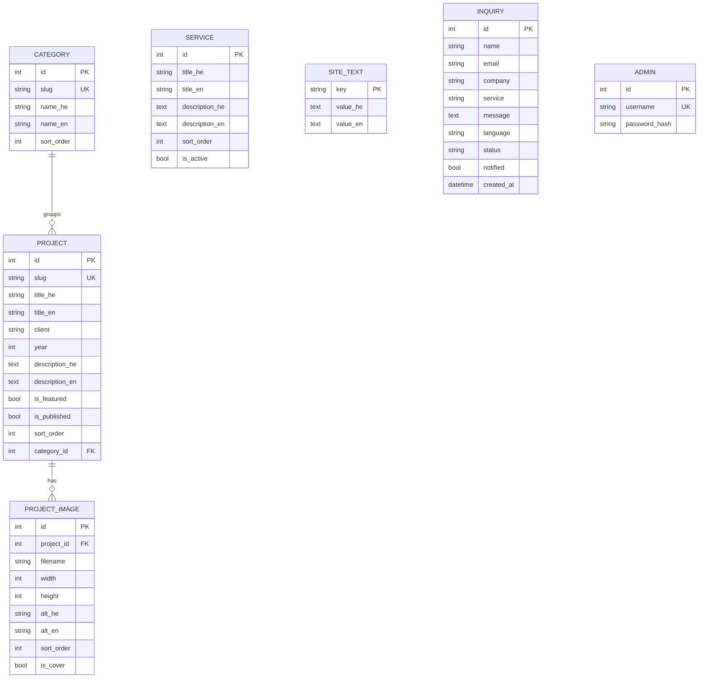

# NOFAI Studio: portfolio website

Bilingual (English / Hebrew) portfolio site for **NOFAI, an AI creative studio**, with a
back-office for managing work, images, texts and incoming inquiries.

**Stack:** Python · Flask (MVC) · Jinja2 · SQLAlchemy · SQLite · Pillow · vanilla JS/CSS.
No front-end frameworks or third-party JS. The smooth "floating" scroll, the lightbox and
the custom cursor are written from scratch, so a strict Content-Security-Policy is possible.

## Run locally

```powershell
pip install -r requirements.txt
flask --app app init-db        # create the database (instance/nofai.db)
flask --app app seed           # admin user + starter category and services
flask --app app seed-demo      # optional: 8 demo projects with placeholder images
flask --app app run --debug --port 5001
```

- Site: <http://localhost:5001> (redirects to /en/ or /he/ by browser language)
- Admin: <http://localhost:5001/admin>, user `nofar`, password `ChangeMe123!` → change it under **החשבון שלי**

Other commands: `flask --app app reset-password` (forgotten password), `python -m pytest tests -q` (61 tests).

## Pages

| Public (`/en/…` and `/he/…`) | Admin (`/admin`, Hebrew) |
|---|---|
| Home: floating hero, statement, selected work, services, quote, CTA | Dashboard |
| About: portrait, story, services, process, tools | Inquiries (status: new / replied / archived) |
| Work: category filter, masonry gallery, lightbox per campaign | Projects: details, multi-image upload, cover, order, alt text |
| Contact: form (AJAX, works without JS) + direct links | Categories · Services · Site texts (+ About portrait) · Account |

## Architecture

```
app.py · config.py
nofai/
  __init__.py        app factory, template helpers, /media route, 404
  i18n.py            interface strings (en/he), language detection
  site_texts.py      registry of editable copy (+ draft starter text)
  storage.py         image upload: validate, resize, re-encode to WebP (local disk)
  mailer.py          new-inquiry e-mail (SMTP; logs instead when not configured)
  validators.py      server-side validation for every form
  security.py        security headers (CSP), login throttling
  cli.py             init-db, seed, seed-demo, reset-password
  models/            Admin, Category, Project, ProjectImage, Service, SiteText, Inquiry
  routes/            public.py (/<lang>/…), admin.py, admin_content.py
  templates/         base.html, public/, admin/
  static/            css/site.css, css/admin.css, js/float.js, lightbox.js, site.js, contact.js, admin.js
tests/
```

**Data model**



Every translatable field exists in both languages; when one is empty the other is shown.

## Design notes

- Palette: cream `#F5F0E8`, sand `#EAE1D3`, beige `#D6C7B0`, taupe `#6E655B`, ink `#2A2622`
- Type: Cormorant Garamond / Noto Serif Hebrew (display), Jost / IBM Plex Sans Hebrew (text), Pinyon Script ("studio")
- **Floating scroll** (`float.js`): native scrolling is kept (accessibility, anchors, touch); every
  `[data-speed]` element trails a smoothed scroll value at its own depth. Entrance animations use
  the CSS `translate` property so they compose with the `transform` written by the script.
- `prefers-reduced-motion` → a fully static page.

## Configuration (environment variables)

| Variable | Purpose |
|---|---|
| `SECRET_KEY` | Required in production (`APP_ENV=production`) |
| `ADMIN_USERNAME` / `ADMIN_PASSWORD` | Account created by `flask seed` |
| `SMTP_HOST`, `SMTP_PORT`, `SMTP_USERNAME`, `SMTP_PASSWORD`, `MAIL_FROM`, `NOTIFY_EMAIL` | New-inquiry e-mails (e.g. Gmail: `smtp.gmail.com`, port 587, an App Password) |
| `UPLOAD_DIR` | Where uploaded images are stored (default `instance/uploads`) |
| `DATABASE_URL` | Another database (e.g. PostgreSQL) instead of SQLite |

> The site copy (about, story, process, services, quote…) is a **draft** written for the project.
> Edit it from **Admin → טקסטים באתר / שירותים**.
